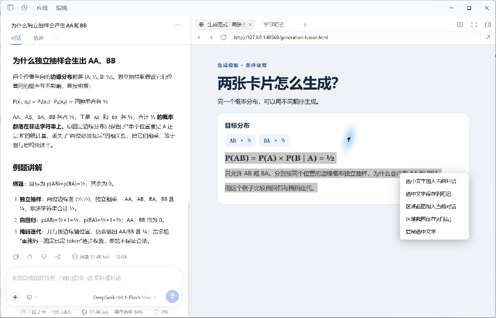

# Learn Notes for DeepSeek Harness

[简体中文](README.md) · [35-second demo](https://www.bilibili.com/video/BV1eoyhz6EUp/)

**dsh-note-to-learn** is an independent, MIT-licensed plug-in for DeepSeek Harness Desktop. Read sources in the DSH sidebar, ask about a selection, and save the useful parts of the answer in an editable notebook.



## Install on Windows

Open the DSH Desktop plug-in manager, choose the official npm registry, and search for `dsh-note-to-learn`. If Desktop has registered the `dsh` command, close Desktop and run the following in PowerShell.

```powershell
dsh plugin --profile desktop add dsh-note-to-learn@0.1.8
```

[View the npm package](https://www.npmjs.com/package/dsh-note-to-learn/v/0.1.8)

### Install from GitHub

The plug-in targets DSH Desktop 0.2.2 release candidates. Open Desktop once to initialize its profile. Download the installation package from [GitHub Releases](https://github.com/shiyan688/dsh-note-to-learn/releases) and add it from the Desktop plug-in manager. If DSH Desktop has registered the `dsh` command, you can also close Desktop and install the downloaded package from PowerShell.

```powershell
dsh plugin --profile desktop add '.\dsh-note-to-learn-0.1.8.tgz'
```

Reopen Desktop, open a workspace session, and choose **学习笔记** in the right sidebar tools or at the bottom of the left sidebar. Choose **English** in the notebook's **语言 / Language** selector. Menus, dialogs, and new suggested questions follow that setting. Your existing note content and titles stay in the language you wrote them in.

## Read, ask, and save the answer

1. Select text in the sidebar browser or PDF preview, then right-click to add it to the conversation draft or save it to a note. The same menu starts a region screenshot.
2. On a note page, select text or an image, or lasso handwriting. Choose **Ask AI about selection** to add the material to the DSH composer. A locally generated question appears in gray. Press **Tab** to accept it, or **Esc** to dismiss it. Edit the draft and send it when ready. Image analysis requires a model that accepts images.
3. Select part of a DSH reply and right-click to save it. Click the destination page to place the excerpt, or append it to the page. Comparisons, step-by-step derivations, and task lists become editable note content. The original excerpt stays available to expand.

The **Import & backup** menu imports local PDF and Markdown files. An online PDF must allow direct access. If the site blocks it, download the file and import it locally. Imported PDFs keep their page numbers and support annotations.

## Local notebook and agent tools

Type or paste `$...$` for an inline formula or `$$...$$` for a display formula in a regular rich-text block. Click a formula to edit the LaTeX.

Use **Insert image or file attachment** on the paper toolbar or drop a local image where you want it on the page. You can also paste an image from the clipboard into a regular text block and save web or PDF region captures as image blocks.

Choose **Page actions → Insert Two Cards** to add a probability exercise. Switch between drawing without replacement and independent draws to compare the four outcome probabilities. Record a summary and a question, then use **Add to DSH draft** to put the exercise state and your question into the editable composer.

**Page actions** also has a clickable flow diagram and an interactive bar chart. Open a step to read its explanation, or switch scenarios to compare values on a shared scale. Use **Edit Markdown** to change the data in the `note-figure` block. Markdown exports retain the figure data. Agent previews and exported PDFs show the default state.

Organize pages into notebooks, sections, and subpages. Link pages, add tags, and search text and OCR results. Use rich text, tables, checklists, attachments, pressure-sensitive ink, highlighters, an eraser, and shapes on the canvas. Pages have version history and a trash folder. On-device OCR reads Simplified Chinese and English.

Notes live in `$DSH_HOME/storages/dsh-note-to-learn`, grouped by workspace path. Sessions in the same workspace share notes. Export the visual page as PDF, editable text as Markdown, or a full workspace backup as JSON. Markdown exports with attachments come as a ZIP. Restoring a backup replaces the workspace's notes. Page history stays in the local data directory.

The DSH agent can browse the notebook hierarchy and recycle bin with `note_list` and find and read notes with `note_search` and `note_read`. The `note_create` and `note_edit` tools guide the agent to use renderable LaTeX, define symbols and assumptions, and illustrate each difficult point with a small figure and example. Their parameters include mixed Markdown and interactive figure examples. With `note_manage`, the agent can create notebooks and sections, rename entries, move or copy pages, and trash or restore entries. Read the latest `blockVersion` before replacing or removing a block with `note_edit`. A successful write returns the saved `revision`.

After an edit, the tool result asks the agent to review the page visually. The agent uses `note_read({ pageId, preview: true })` to check the equations, figure labels, and table legibility in a full-page image of that revision. It fixes issues and checks a fresh preview. This requires an image-capable model and the session to be open in DSH Desktop or the web client.

## Develop

```powershell
npm ci
npm test
npm pack
```

Set `DSH_NOTE_TEST_BROWSER` to the Chrome or Edge executable before running `npm test` to exercise real measurements at both zoom levels and the rendered image round trip. Set `DSH_NOTE_TEST_RUNTIME` to a separate npm directory with DSH `0.2.3-alpha.2` installed to exercise reloads against its tool registry.

The browser bundle is built with esbuild. The client talks to the host through DSH's authenticated connection. PDF.js resources and OCR language data are installed as dependencies. See [LICENSE](LICENSE) for the plug-in license. Dependencies carry their own licenses.

After changing the client, run `npm run build` and commit the regenerated `dist/client.js` alongside the source. Plugin markets that install from GitHub use that file directly.
