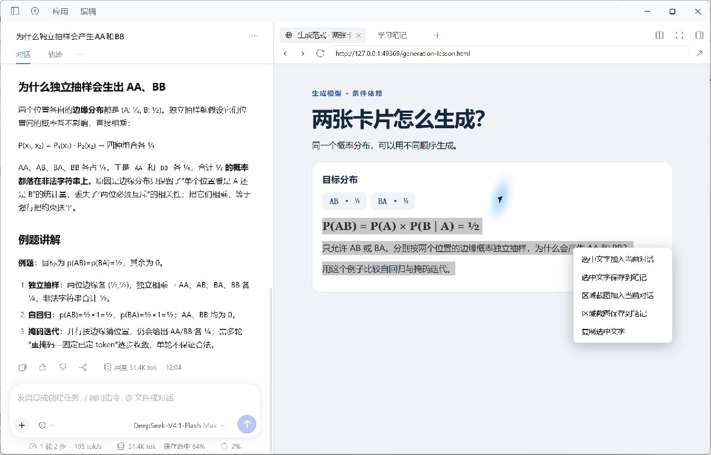

# dsh-note-to-learn

[English](README.en.md) · [35 秒实机演示](https://www.bilibili.com/video/BV1eoyhz6EUp/)

在 DeepSeek Harness 的右侧栏读资料、手写和整理笔记。把网页、PDF 或纸面选区放进当前 DSH 对话，选中有用的回答再放回纸面。



## 在 Windows 安装

在 DSH Desktop 的插件管理中选择官方 npm 注册表，搜索 `dsh-note-to-learn`。如果已经注册了 `dsh` 命令，也可以完全退出 Desktop 后在 PowerShell 中运行：

```powershell
dsh plugin --profile desktop add dsh-note-to-learn@0.1.6
```

[查看 npm 安装包](https://www.npmjs.com/package/dsh-note-to-learn/v/0.1.6)

### 从 GitHub 安装

从 [GitHub Releases](https://github.com/shiyan688/dsh-note-to-learn/releases) 下载 `dsh-note-to-learn-0.1.6.tgz`。插件面向官方 DSH Desktop 0.2.2 候选版本。先启动一次 Desktop 初始化，再在插件管理中添加下载的安装包。

如果已通过 Desktop 注册 `dsh` 命令，也可以完全退出 Desktop，在安装包所在目录执行以下命令。

```powershell
dsh plugin --profile desktop add '.\dsh-note-to-learn-0.1.6.tgz'
```

重新打开 Desktop，进入一个有工作区的会话，在右侧栏的工具列表选择 **学习笔记**。左侧栏底部也提供 **学习笔记** 入口。

在学习笔记工具栏的 **语言 / Language** 下拉框选择 **简体中文** 或 **English**。菜单、对话框和新生成的追问建议会使用所选语言。已有笔记正文与标题保留原文。

## 阅读、提问和摘录

- 在 DSH 侧栏浏览器或 PDF 预览中选中文字并右键。选择添加到对话或保存到笔记。右键也可以开始区域截图。
- 摘录文字或截图直接进入 DSH 原生草稿，草稿可以编辑和移除材料。点击 DSH 的发送按钮后由当前模型处理。图像分析需要支持图像输入的模型。
- 在纸面上选中文字、图片或套索圈选笔迹，再选 **选区问 AI**。输入框会按选区类型给出一条本地生成的灰色问题建议。按 Tab 接受，按 Esc 或直接输入可忽略。接受建议只修改草稿。
- 在 DSH 回答中选中段落、公式或图片并右键保存。打开目标笔记页后点击纸面放置，或选择追加到页面。比较表、分步推导和待办清单会整理为可编辑内容，并保留可展开的摘录原文。
- 资料菜单可以导入本地 PDF 或 Markdown。在线 PDF 需要站点允许直接读取，站点限制时可先下载再导入。PDF 页面按原页码导入并可在上面写批注。

## 本地笔记

在普通富文本块中输入或粘贴 `$...$` 行内公式、`$$...$$` 独立公式，即可直接显示。单击公式可以修改 LaTeX。

从 **页面操作 → 插入两张卡片** 添加概率练习。切换不放回和独立抽取，比较四种结果的概率，记下总结与疑问。**加入 DSH 草稿** 会把练习状态和你的疑问放进可编辑草稿。

笔记本、分区、子页、页面链接、标签、全文搜索、页面历史、回收站和备份。纸面支持自由排布、富文本、表格、清单、附件、压感笔、荧光、橡皮、形状和撤销重做。图像 OCR 由本机识别简体中文或英语，结果可检索和修改。PDF 导出保留视觉布局，Markdown 和 JSON 备份保留可编辑内容。带素材的 Markdown 导出为 ZIP，里面包含正文和附件。

数据保存在 `$DSH_HOME/storages/dsh-note-to-learn`，按会话工作目录归档。同一工作目录里的会话共享笔记。恢复备份会替换当前工作区的笔记，备份文件包含正文、附件和回收站内容，页面历史留在本机数据目录。云同步、多人协作和录音转写留作后续版本。

DSH Agent 可调用 `note_search`、`note_read`、`note_create` 和 `note_edit`。例如在当前工作区说「找到《线性代数》里的矩阵笔记，把这段解释追加到那一页」。工具读取文字、OCR 和图片描述，追加可编辑 Markdown，替换已有文字块需要先读取最新版本。编辑保留笔迹、图片和其他文字块。

Agent 完成编辑后会收到视觉检查步骤。它用 `note_read({ pageId, preview: true })` 读取同一修订的整页渲染图，检查重叠、截断和表格可读性，修正后再取图核对。运行时需要在 DSH Desktop 或网页客户端打开该会话，并使用支持图片输入的模型。

## 开发

```powershell
npm ci
npm test
npm pack
```

设置 `DSH_NOTE_TEST_BROWSER` 为本机 Chrome 或 Edge 的可执行文件路径后运行 `npm test`，可验证两种缩放下的真实高度和截图回传。将 `DSH_NOTE_TEST_RUNTIME` 指向安装了官方 DSH `0.2.3-alpha.2` 的独立 npm 目录，可同时运行实际工具注册表的卸载重装测试。

浏览器入口由 esbuild 构建。前端通过 DSH 认证连接读写笔记，PDF.js 资源和 OCR 语言数据随依赖分发。项目遵循 MIT。PDF.js、Tesseract 及其他依赖由各自的分发包提供许可。

修改前端后运行 `npm run build`，并随源码提交重新生成的 `dist/client.js`。从 GitHub 源码安装的插件市场会直接使用这个文件。
